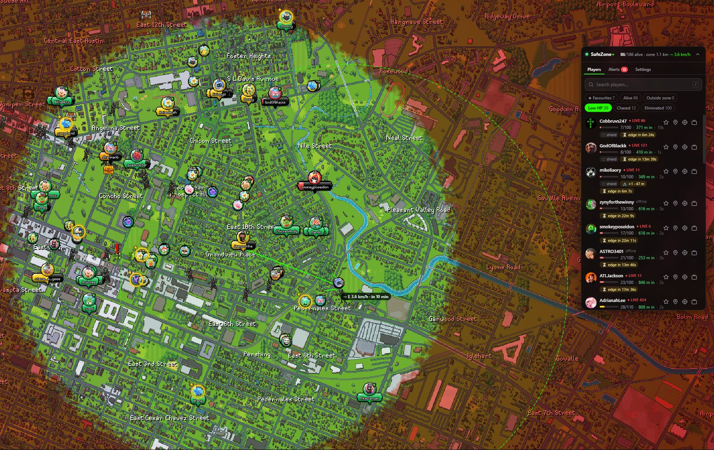
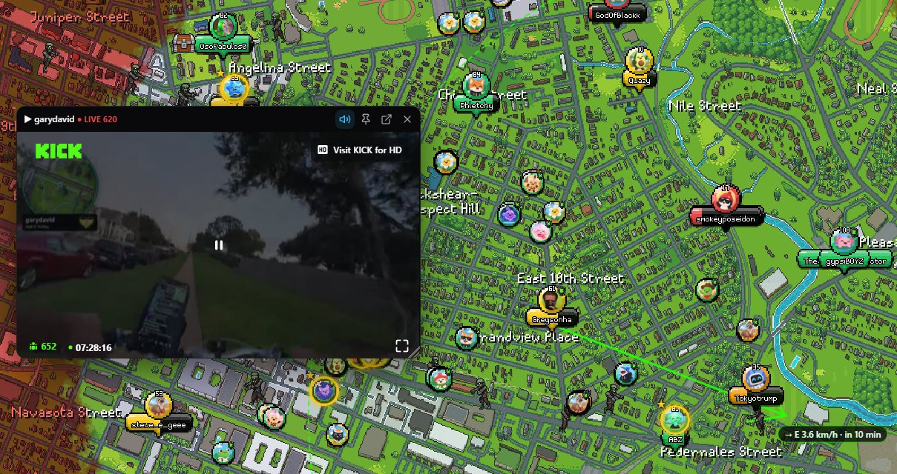
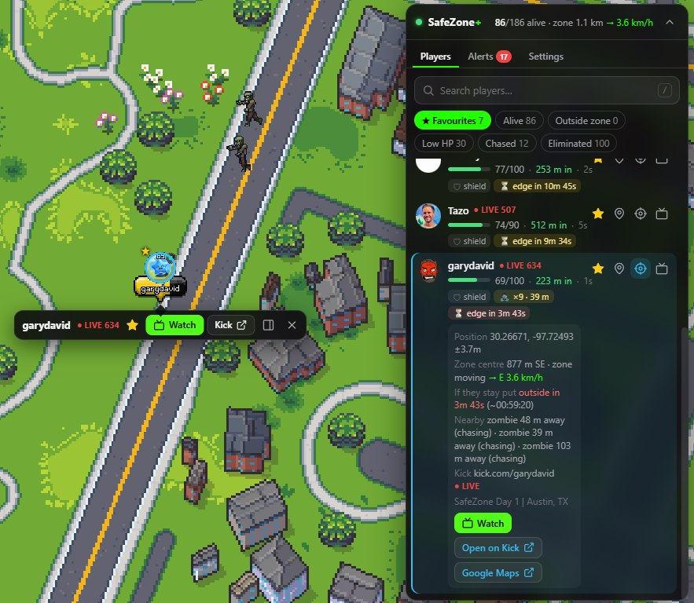
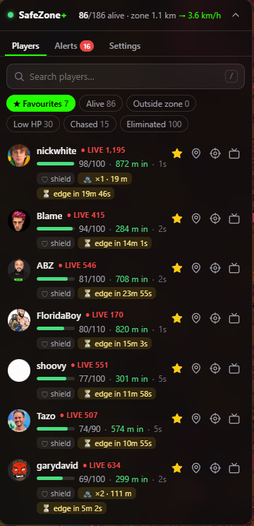
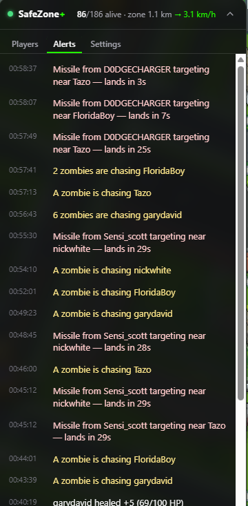
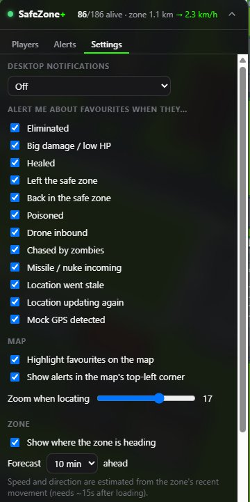

# SafeZone+

Extra features for [Ice Poseidon's Safe Zone](https://iceposeidon.com/safezone/map) live map.
The repo has a reusable TypeScript client for the map's live feed, a CLI for testing it, and a
Chrome extension built on that client.


> **Unofficial fan project.** Not affiliated with or endorsed by Ice Poseidon or the Safe Zone
> event team. It only reads the map's public live feed and changes nothing on the server.



## Install

1. Download `safezone-plus-vX.Y.Z.zip` from the [latest release](../../releases/latest).
2. Unzip it to a folder you'll keep (Chrome loads the extension from that folder).
3. Open `chrome://extensions`, turn on **Developer mode** (top right), click **Load unpacked**
   and pick the unzipped folder (the one containing `manifest.json`).
4. Open <https://iceposeidon.com/safezone/map>. The SafeZone+ panel appears on the map.

SafeZone+ checks this repo for new versions and shows a notice in its panel (plus **NEW** on the
toolbar icon) when one is out. Chrome can't update an unpacked extension by itself, so to update,
download the new zip, replace the folder's contents and press ↻ on the extension in
`chrome://extensions`. Works in Chromium browsers (Chrome, Edge, Brave) version 111+.

## Features

Chrome extension (adds a panel to `/safezone/map`):

- **Player search.** Fuzzy search across every registered player (`/` to focus, Enter jumps to the top hit).
- **Take me there.** 📍 flies the site's own map to the player. 🎯 follows them as they move. Dragging the map stops following.
- **Favourites.** ☆ to star a player. Favourites are pinned in the panel and synced via your Chrome profile. On the map they get a gold ring and ★ attached to the site's own player sprite (through its renderer, so the ring moves with the sprite).
- **Streams.** Shows each player's Kick channel with **LIVE** status and viewer count, verified against their Kick user id. ▶ opens a floating player you can drag and resize; 📌 pins it under the player on the map so it follows them.
- **Zone forecast.** Estimates the zone's drift (direction and km/h) and draws where it will be in N minutes. Each player shows "⏳ edge in 8m", meaning how long until the moving edge reaches them if they stay put.
- **Sorting.** Alive by HP (favourites first), Low HP ascending, Eliminated by time of death (newest first) with the cause or killer.
- **Click a player on the map** to get an action bar under them: ☆ favourite, ▶ watch, open on Kick, show details in the panel. The site draws its player cards on the canvas, so the extension hit-tests clicks itself.
- **Alerts for favourites.** Eliminated, big damage or low HP, left the zone, poisoned, drone inbound, chased by zombies, missile or nuke targeting them, mock GPS. Shown in the map's top-left corner (clicking one jumps to the player) and as optional desktop notifications. Each alert type can be turned on or off.
- **At a glance.** HP bar, metres inside or outside the zone edge, location age, poison and drone countdowns, zombie chasers and nearest distance, incoming projectiles.
- **Filters.** Favourites, Alive, Outside zone, Low HP, Chased, Eliminated.
- **Contestant info.** Inventory, sigil and the activity log from the site's player card, right in the player's details. When the site opens its own card, SafeZone+'s actions (★, Watch, Kick, locate) appear inside it.
- **Multiple zones.** When the event runs several safe zones, distances, edge ETAs and the forecast use their combined area (safe inside any of them).
- **More map room (optional).** *Settings → Site* tucks the site's header away. Move the pointer to the top edge, or click the small tab, to get the tabs and your account menu back.
- **Blackouts (optional).** An EMP is meant to blind contestants, not viewers. Turn on *Settings → Blackouts* to keep seeing players during one; anyone whose position stops updating stays at their last known spot (dashed).
- **Details.** Coordinates with a Google Maps link, distance and direction to the zone centre, whether the player will still be inside after the current shrink, and nearby zombies, chests and items.

## Screenshots

**Watch a stream on the map.** Drag, resize, mute, or 📌 pin it under the player so it follows them.



**Click a player** for the action bar, or expand them in the panel for position, zone ETA,
nearby zombies and links.



| Favourites | Alerts | Settings |
| --- | --- | --- |
|  |  |  |

## CLI

`npm run cli -- <command>`:

```text
stats                      zone, alive count, outside-zone and lowest-HP players
search <query>             fuzzy-search players
player <name> [--kick]     full detail for one player (+ Kick live status)
watch <name...> | all      live alert feed
capture <file> [seconds]   record raw socket frames to NDJSON
```

## Development

Requires Node 22+.

```sh
npm install
npm test              # decoder/state/extension tests against captured live frames
npm run cli -- stats  # talk to the live event
npm run build:ext     # → extension/dist
npm run package:ext   # → release/safezone-plus-v<version>.zip (attach to a GitHub release)
```

To run a local build, **Load unpacked** → select `extension/dist`.
Use `npm run watch:ext` while developing, and reload the extension after each change.

## Releasing

1. Bump `version` in `extension/manifest.json` (and `package.json`).
2. `npm run package:ext` builds `release/safezone-plus-v<version>.zip` and syncs `version.json`.
   Write a one-line summary in its `notes`.
3. Publish a GitHub release (tag `v<version>`) with the zip attached.
4. **Then** commit and push `version.json` to `main`. Installed copies poll
   `raw.githubusercontent.com/.../main/version.json` every few hours, so pushing it earlier would
   announce an update nobody can download yet.

## How it works

The map's live feed is a public WebSocket that mixes JSON frames with a custom columnar binary
format. It was reverse engineered from the site's obfuscated client; the full wire format is in
**[docs/PROTOCOL.md](docs/PROTOCOL.md)**.

```text
src/core/            environment-agnostic (Node 22 + browser)
  binary.ts          36-byte header + per-kind columnar decoders, multipart reassembly
  messages.ts        JSON message types
  state.ts           SafeZoneState: mirrors the site's client (slots↔users, full/sparse, watermarks)
  client.ts          snapshot bootstrap + WebSocket + jittered backoff + resync on gaps
  alerts.ts          per-player transition alerts with thresholds/cooldowns
  geo.ts kick.ts search.ts
src/cli/             test harness
extension/src/
  content/           panel UI (Shadow DOM), runs its own feed client
  bridge.ts          MAIN-world script: drives the site's MapLibre map (fly/follow/labels)
  map-discovery.ts   finds the Map instance via React's fiber tree
  background.ts      Kick API lookups + notifications
scripts/site/pull.mjs  re-download + deobfuscate the site's bundles into .site/ (npm run site:pull, not committed)
```

The extension opens its own connection to the public feed rather than tapping the page's socket,
so it keeps working (and alerting) while the tab is in the background. The site pauses its own
socket in that case.

### Respecting the game's restrictions

While the map is **anonymous** or the public map is disabled, SafeZone+ hides positions, health
and map labels, the same way the site does. During an EMP or smoke **blackout** it does the same
by default. Per the event developer, the EMP is meant to stop contestants seeing each other
rather than viewers, so *Settings → Blackouts* can keep players visible.

## Status / next ideas

- Background alerts while the map tab is closed (keep the feed in the service worker).
- Multi-stream grid (the site has a hidden 4-up viewer; ours could use favourites).
- Zone-shrink warnings: "favourite will be outside in N min at walking pace".
- Leaderboards (`/public/leaderboards`) and sigil poll in the panel.
- Kill feed and history from `game_items` gravestones; HP sparkline per favourite.

## License

[MIT](LICENSE)
